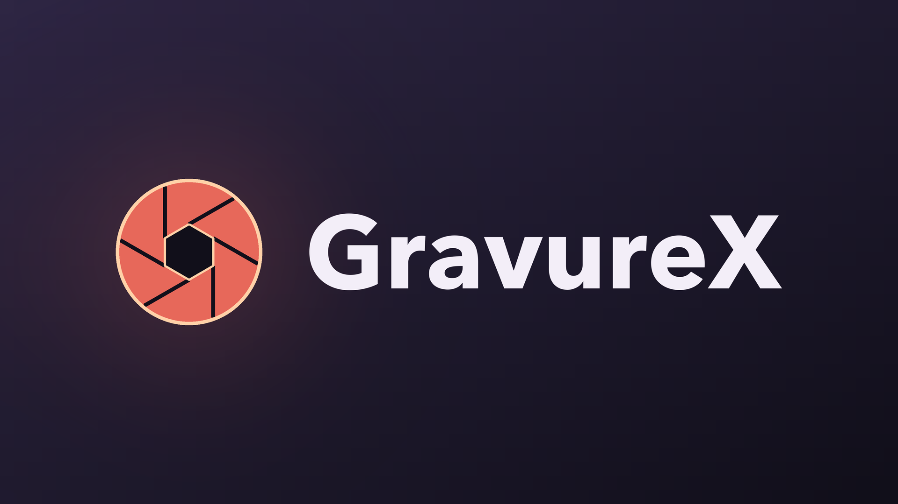

<div align="center">



**Metadata and artwork for Japanese DVD and Blu-ray releases, in Jellyfin**

Focused on the gravure idol category · Read from public product pages · No API key or login

[](https://jellyfin.org)
[](https://dotnet.microsoft.com)
[](https://learn.microsoft.com/dotnet/csharp/)
[](LICENSE)
[](https://github.com/sdtafxy/jellyfin-plugin-gravurex/releases)
[](https://github.com/sdtafxy/jellyfin-plugin-gravurex/actions)
[](https://github.com/sdtafxy/jellyfin-plugin-gravurex/releases)
[](https://github.com/sdtafxy/jellyfin-plugin-gravurex/commits/main)
[](https://github.com/sdtafxy/jellyfin-plugin-gravurex)
[](https://github.com/sdtafxy/jellyfin-plugin-gravurex)

[简体中文](README.md) · **English**

</div>

## ✨ Features

- 📋 **Metadata** — title, overview, release date, runtime, maker, genres, JAN barcode, rating, performers and director
- 🔢 **Content number in the title** — results read as `AB123-4567 タイトル`. The number comes from your file name, keeping whichever hyphen position you use
- 🖼️ **All three image types** — poster, backdrop and thumbnail are always supplied, so no slot is left empty
- 🎭 **Performers** — canonical name, kana reading and actor id, plus a portrait where the source publishes one
- 🔍 **Lenient matching** — `AB123-4567`, `ab1234567`, `AB-1234567` and `n_1234abcd5678` all resolve
- 💿 **Editions told apart** — when a number has a plain, a Blu-ray and a limited edition, a scan takes the plain one and a manual search shows them all
- 🌐 **Network control** — HTTP proxy, request throttling, timeout and page caching, with defaults that are gentle on the source

Metadata is kept in Japanese as published, and is not translated.

## ✅ Requirements

| Item | Requirement |
|---|---|
| **Jellyfin** | 10.11.x |
| **Runtime** | .NET 9.0, bundled with Jellyfin 10.11 — nothing to install |
| **Network** | Access to `dmm.com` and `pics.dmm.com`. Set the HTTP proxy in the plugin settings if the server cannot reach them directly |

## 🚀 Installation

### From the plugin repository (recommended)

1. Open **Dashboard → Plugins → Repositories** and add the address below

   ```
   https://raw.githubusercontent.com/sdtafxy/jellyfin-plugin-gravurex/main/manifest.json
   ```

2. Open the **Catalog** tab, find **GravureX** under *Metadata* and install it
3. **Restart Jellyfin**
4. Open **Dashboard → Plugins → GravureX** and configure it
5. In your movie library, enable **GravureX** under metadata downloaders and image fetchers

New versions then appear in the catalogue and can be installed in place.

### Manual install

1. Download `jellyfin-plugin-gravurex-*.zip` from [Releases](https://github.com/sdtafxy/jellyfin-plugin-gravurex/releases)
2. Extract it into the Jellyfin `plugins` directory as `plugins/Jellyfin.Plugin.GravureX/`
3. Restart Jellyfin, then configure the plugin and enable it in your library

<details>
<summary><b>Build from source</b></summary>

```bash
dotnet publish Jellyfin.Plugin.GravureX/Jellyfin.Plugin.GravureX.csproj \
  -c Release -o ./artifacts
```

Copy the contents of `./artifacts` into `plugins/Jellyfin.Plugin.GravureX/`.
</details>

## ⚙️ Settings

Everything lives under **Dashboard → Plugins → GravureX**.

| Setting | Default | Description |
|---|---|---|
| HTTP proxy | *(empty)* | e.g. `http://127.0.0.1:7890`, for a server that cannot reach the source directly |
| User agent | *(bundled)* | Empty uses the built-in default |
| Minimum delay between requests | `1500` ms | Higher values are gentler; do not lower it |
| Request timeout | `30` s | Per request |
| Cache duration | `1440` min | `0` disables the cache |
| Resolve content numbers via search | on | Required to match content numbers; not needed when file names carry a full content id |
| Put the content number in front of the title | on | Results read as `AB123-4567 タイトル` |
| Prefer the standard edition | on | On: only the plainest edition is used. Off: a manual search lists every edition (plain, Blu-ray, limited bonus); an automatic scan always takes the plain one |
| Store the JAN barcode | on | |
| Import genres | on | |
| Add the series as a tag | on | The media type is added too when the page publishes one |
| Add the director to the people | *off* | Off keeps the people list to the performers only |
| Maximum preview images to offer | `50` | `0` means no limit; how many are saved is decided by the library's image limit |
| Look up performer portraits | on | See the note below |
| Performer index cache | `7` days | Rebuilding costs about fourteen requests |

## 📝 File naming

The content number or the full content id is read from the file name, falling back to the containing folder name.

| File name | Matched as |
|---|---|
| `AB123-4567.mp4` | content number `AB123-4567` |
| `ab1234567.mp4` | content number `ab1234567` |
| `AB-1234567.mp4` | content number `AB-1234567` |
| `[AB123-4567] タイトル.mp4` | content number `AB123-4567` |
| `n_1234abcd5678.mp4` | content id, fetched directly |

Hyphens are ignored while matching, so they may sit wherever you prefer. Zero padding is tolerated as well, because the source pads the numeric part differently per maker. When several editions of a title exist, the standard edition is preferred.

## 💡 Notes

> [!TIP]
> **Refresh with "Replace all images" on the first scrape.** An automatic scan takes one image per type — the cropped front cover for the poster, the package spread for backdrop and thumbnail — so replacing guarantees all three are written. The manual picker lists every image the plugin offers.

> [!NOTE]
> **Pre-order titles often have no preview gallery**, so the backdrop and thumbnail fall back to the package spread.
>
> **Most performers have no portrait.** The source publishes one for only a small subset, and it publishes no biography or birth date either.

When troubleshooting, open **Dashboard → Logs** and search for `GravureX` to see what artwork each scrape offered; switch the log level to `Debug` to see every image URL.

Implementation details — image URL patterns, field mapping and so on — are in [docs/data-source.md](docs/data-source.md).

## 📄 Licence

[MIT](LICENSE)
